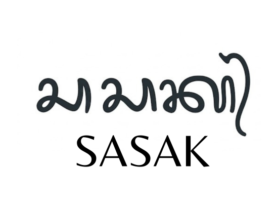

# Sasak Script

<p align="center">
  
</p>

**Bahasa Lokal, Logika Global.**

*Sebuah langkah kecil dari pemuda Lombok Utara untuk menjaga bahasa daerah melalui dunia pemrograman.*

## Tentang Sasak Script

**Sasak Script** adalah proyek pengembangan bahasa pemrograman yang menggunakan kosakata bahasa Sasak sehari-hari masyarakat Lombok Utara. Proyek ini dibangun menggunakan JavaScript dan Node.js, dengan tujuan memperkenalkan logika dasar pemrograman melalui bahasa yang dekat dengan kehidupan masyarakat setempat.

Sasak Script bukan hanya tentang membuat bahasa pemrograman baru, tetapi juga tentang bagaimana bahasa daerah dapat memiliki tempat dalam perkembangan teknologi modern.

Proyek ini masih dalam tahap pengembangan dan akan terus diperbaiki serta dikembangkan secara bertahap.

## Latar Belakang

Bahasa daerah merupakan bagian dari identitas, budaya, dan warisan yang diwariskan dari satu generasi ke generasi berikutnya. Di Lombok Utara, bahasa Sasak telah menjadi bagian dari kehidupan masyarakat, digunakan dalam percakapan sehari-hari, lingkungan keluarga, dan berbagai kegiatan sosial.

Namun, seiring perkembangan zaman, muncul kekhawatiran bahwa penggunaan bahasa daerah mulai berkurang, khususnya di kalangan generasi muda. Saat ini, semakin jarang terdengar anak-anak menggunakan bahasa Sasak dalam percakapan sehari-hari. Bahasa Indonesia dan bahasa lainnya semakin banyak digunakan, sementara bahasa daerah perlahan mulai kurang mendapatkan ruang.

Perubahan tersebut bukan berarti perkembangan zaman harus ditolak. Justru muncul sebuah pertanyaan: **bagaimana jika kemajuan teknologi juga dapat menjadi sarana untuk menjaga bahasa daerah agar tetap dikenal oleh generasi berikutnya?**

Dari pertanyaan sederhana inilah gagasan Sasak Script mulai muncul.

## Mengapa Proyek Ini Dibuat?

Proyek ini berawal dari keresahan seorang pemuda Lombok Utara yang melihat perubahan penggunaan bahasa dalam kehidupan sehari-hari, terutama di kalangan anak-anak dan generasi muda.

Sebagai seseorang yang sedang mempelajari ilmu komputer dan dunia pemrograman, muncul keinginan untuk menghubungkan dua hal yang mungkin terlihat berbeda, yaitu **bahasa daerah dan teknologi**.

Selama ini, bahasa pemrograman umumnya menggunakan kosakata bahasa Inggris. Kata-kata seperti `if`, `else`, `while`, `function`, dan `return` menjadi bagian dari proses belajar coding.

Dari situ muncul sebuah pemikiran sederhana:

**Mengapa kita tidak mencoba memperkenalkan konsep pemrograman menggunakan bahasa yang kita gunakan sehari-hari?**

Pemikiran tersebut menjadi awal pengembangan Sasak Script. Bahasa Sasak tidak hanya digunakan untuk berkomunikasi, tetapi juga dicoba untuk diperkenalkan sebagai bagian dari pembelajaran teknologi.

Proyek ini bukan dibuat karena ingin menggantikan bahasa pemrograman yang sudah ada, melainkan sebagai bentuk pembelajaran, eksperimen, dan upaya kecil untuk memperkenalkan kembali bahasa daerah dengan cara yang berbeda.

## Tujuan Pengembangan

Sasak Script dikembangkan dengan beberapa tujuan:

1. **Melestarikan bahasa daerah.** Memperkenalkan kembali kosakata bahasa Sasak Lombok Utara melalui pendekatan teknologi.
2. **Membantu pemula belajar coding.** Menyediakan sarana untuk memahami variabel, kondisi, perulangan, fungsi, dan logika dasar pemrograman.
3. **Mendekatkan teknologi dengan budaya lokal.** Menunjukkan bahwa bahasa daerah juga dapat menjadi inspirasi dalam pengembangan teknologi.
4. **Mendorong kreativitas generasi muda.** Mengajak anak-anak dan pemuda untuk tidak hanya menggunakan teknologi, tetapi juga belajar menciptakannya.
5. **Membuka ruang pengembangan bersama.** Menjadikan Sasak Script sebagai proyek terbuka yang dapat dipelajari, diperbaiki, dan dikembangkan oleh siapa saja.

## Mengapa Menggunakan Bahasa Sasak Lombok Utara?

Bahasa Sasak memiliki beragam dialek dan variasi kosakata yang digunakan oleh masyarakat di berbagai wilayah Pulau Lombok.

Pada tahap awal, Sasak Script berfokus pada kosakata yang digunakan dalam percakapan sehari-hari masyarakat Lombok Utara, yang dalam proyek ini disebut **Lotura**.

Pemilihan ini didasarkan pada kedekatan pengembang dengan bahasa dan lingkungan tempat tinggalnya. Dengan menggunakan kosakata yang dikenal dalam kehidupan sehari-hari, proses pengembangan diharapkan dapat dilakukan secara lebih alami.

Ke depannya, Sasak Script terbuka untuk pengembangan dan masukan dari penutur bahasa Sasak di wilayah lainnya.

## Sebuah Harapan untuk Generasi Mendatang

Sasak Script mungkin dimulai dari sebuah proyek kecil dan sederhana. Namun, di balik proyek ini terdapat harapan agar generasi muda tidak melupakan bahasa yang menjadi bagian dari identitas daerahnya.

Kemajuan teknologi seharusnya tidak selalu membuat kita meninggalkan budaya dan bahasa sendiri. Sebaliknya, teknologi dapat menjadi salah satu jalan untuk memperkenalkan, menjaga, dan mengembangkan warisan tersebut.

Harapannya, suatu hari nanti anak-anak Lombok Utara dapat mengenal logika pemrograman melalui kata-kata yang pernah mereka dengar dari orang tua, keluarga, dan lingkungan tempat mereka tumbuh.

Tidak harus langsung menjadi programmer. Setidaknya, mereka dapat mengenal bahwa bahasa daerah mereka juga bisa hadir dalam dunia teknologi.

## Pesan dari Pengembang

Saya menyadari bahwa membangun sebuah bahasa pemrograman bukanlah pekerjaan yang mudah. Masih banyak hal yang harus dipelajari, diperbaiki, dan dikembangkan.

Saya juga tidak menganggap proyek ini sebagai solusi tunggal untuk menjaga keberlangsungan bahasa daerah. Sasak Script hanyalah salah satu bentuk usaha kecil yang bisa saya lakukan melalui bidang yang sedang saya pelajari.

Saya percaya bahwa menjaga bahasa daerah bukan berarti menolak perkembangan zaman. Kita bisa terus belajar teknologi, mengikuti perubahan, dan mengenal dunia yang lebih luas tanpa harus melupakan bahasa serta budaya tempat kita berasal.

**Jika suatu hari bahasa Sasak semakin jarang terdengar dalam percakapan sehari-hari, setidaknya kita pernah berusaha menghadirkannya melalui cara yang kita mampu.**

Semoga proyek sederhana ini dapat menjadi awal dari sesuatu yang bermanfaat, baik untuk pembelajaran pemrograman maupun untuk memperkenalkan bahasa Sasak kepada generasi berikutnya.

**Hampure**, mohon maaf apabila ada kata yang salah digunakan karena masih dalam tahap pengembangan. Masukan dari para penutur bahasa Sasak sangat diharapkan agar kosakata yang digunakan dapat diperbaiki dan semakin sesuai dengan penggunaan sehari-hari.

---

**Sasak Script — Bahasa Lokal, Logika Global.**

*Dibuat dari Lombok Utara, untuk siapa saja yang ingin belajar, berkarya, dan menjaga bahasa daerah.*

## Instalasi dan penggunaan

**Yang perlu dipasang:** Node.js **24 LTS** (sudah termasuk npm) dan Git untuk
mengunduh repository. VS Code opsional sebagai editor. Proyek tidak memerlukan
database, API key, Python, atau dependensi eksternal.

Unduh dari [Node.js](https://nodejs.org/en/download), [Git](https://git-scm.com/downloads),
dan opsional [VS Code](https://code.visualstudio.com/download). Setelah instalasi,
buka terminal baru dan periksa `node --version`, `npm --version`, serta `git --version`.

Dari terminal:

```sh
git clone https://github.com/Edong098/sasak-script.git
cd sasak-script
npm ci
npm test
node src/cli/cli.js examples/belajar.lu
```

Jika repository sudah tersedia, cukup masuk ke foldernya. Semua perintah npm
dijalankan dari folder yang berisi `package.json`. Paket belum dipublikasikan ke
npm; instalasi dilakukan dari repository ini.

Untuk mengaktifkan nama CLI `sasak`, jalankan dari folder proyek:

```sh
npm link
sasak --help
sasak --version
sasak examples/belajar.lu
```

Tanpa `npm link`, gunakan `node src/cli/cli.js <file.lu>` atau
`npm start -- <file.lu>`. Cara langsung melalui Node tidak memerlukan perubahan
PATH atau hak administrator.

Pada Windows/PowerShell, gunakan `npm.cmd` atau `sasak.cmd` bila script `.ps1`
diblokir; tidak perlu menonaktifkan kebijakan keamanan PowerShell.

Lihat **[panduan instalasi lengkap](docs/installation.md)** untuk Windows/VS Code,
Linux/macOS, pengaturan PATH, pembuatan file pertama, troubleshooting, dan pembaruan.

## Program pertama

Simpan sebagai `belajar.lu`, lalu jalankan `sasak belajar.lu`:

```text
pengaq aran = "Ahmad"
pengaq umur = 22

gaweq salam(nama):
    gitaq("Halo " + nama)

salam(aran)

lamun (umur >= 17):
    gitaq("Sudah dewasa")
deq:
    gitaq("Belum dewasa")
```

Output:

```text
Halo Ahmad
Sudah dewasa
```

Gunakan **empat spasi** untuk setiap tingkat indentasi. Blok diawali titik dua,
komentar diawali `#`, dan pemanggilan fungsi menggunakan tanda kurung.

## Perulangan `untuk` dan `lanjutkan`

```text
untuk (pengaq i = 0; i < 5; i = i + 1):
    lamun (i == 2):
        lanjutkan
    gitaq(i)
```

Output: `0`, `1`, `3`, `4`, masing-masing pada baris baru.

Header `untuk` terdiri dari deklarasi awal, kondisi, dan pembaruan penghitung.
Titik koma hanya digunakan sebagai pemisah bagian header ini. `lanjutkan`
melewati sisa iterasi, sedangkan `mengenteng` menghentikan loop.
`lanjutkan` juga dapat digunakan dalam perulangan `semasih`.

## Fitur yang tersedia

| Fitur | Keyword atau sintaks |
| --- | --- |
| Variabel dan output | `pengaq`, `gitaq()` |
| Boolean dan null | `tetu`, `salaq`, `deq_araq` |
| Kondisi dan logika | `lamun`, `deq`, `dan`, `atau`, `bukan` |
| Perulangan | `semasih`, `untuk`, `mengenteng`, `lanjutkan` |
| Fungsi dan return | `gaweq`, `sempuleq`; lexical scope, closure, recursion |
| Struktur data | Array, object, indexing, property access, assignment |
| Object-oriented programming | `bale`, `sandiang`, `niki`, `jariang`, `tunang`, `lokaq`, `melengo` |
| Modul relatif | `temang`, `sugulang` |
| Penanganan error | `cobaq`, `bauang`, `pelewas` |
| Async dan await | `liwatin`, `anti` |

Program dijalankan melalui **Lexer → Tokens → Parser → AST → Interpreter**,
tanpa `eval()` atau `new Function()`. Error bahasa menyertakan nama file, baris,
dan kolom. CLI keluar dengan status `1` jika program gagal.

## Contoh dan pengujian

Contoh siap dijalankan berada di [`examples/`](examples/), dari matematika hingga OOP,
modul, dan async. Misalnya:

```sh
sasak examples/persegi.lu
sasak examples/untuk.lu
sasak examples/oop.lu
npm test
```

Pengujian menggunakan `node:test` dan mencakup unit test, regresi, serta integrasi
CLI. GitHub Actions dikonfigurasi untuk Node.js 24 pada Linux dan Windows.

## Dokumentasi

- [Instalasi dan troubleshooting](docs/installation.md)

- [Tutorial untuk pemula](docs/tutorial.md)
- [Sintaks dan semantik](docs/syntax.md)
- [Kamus keyword resmi](docs/keywords.md)
- [Arsitektur interpreter](docs/architecture.md)
- [Roadmap](docs/roadmap.md)
- [Changelog](CHANGELOG.md)

## Status pengembangan

Versi **`0.1.0-dev.0`** merupakan prototipe pengembangan. Fitur di atas telah diuji,
namun spesifikasi dan API belum dinyatakan stabil. Belum ada rilis publik atau
publikasi npm.

Batasan saat ini:

- Ekspresi ditulis pada satu baris; indentasi memakai spasi, bukan tab.
- Tidak ada konversi tipe otomatis antara string dan angka.
- Index array harus berada dalam batas; belum tersedia operasi append.
- Impor modul melingkar ditolak; await hanya tersedia dalam fungsi async.
- Belum tersedia standard library I/O atau cancellation.
- Angka memakai IEEE-754 sehingga integer besar dapat kehilangan presisi.

Rincian perilaku dan batasan dijelaskan dalam [dokumentasi sintaks](docs/syntax.md).

## Keamanan

Source `.lu` tidak mendapat API shell, jaringan, JavaScript host, atau akses file
selain impor modul. Impor dibatasi ke folder file utama, termasuk pemeriksaan
symlink. Ada batas ukuran source, token, kedalaman, langkah, waktu, tugas async,
string, dan output; pelanggaran menghentikan program dengan `LimitError`.
Karakter kontrol berbahaya ditampilkan sebagai teks oleh CLI.

Instalasi menonaktifkan lifecycle script npm melalui `.npmrc`. Proyek tidak memiliki
dependensi eksternal; GitHub Actions dipin ke commit dan memakai izin baca.

Perlindungan ini bukan antivirus atau isolasi sistem operasi. Jangan menjalankan
JavaScript repository, instalasi, atau program tak dipercaya dengan hak admin.
Untuk source yang benar-benar tak dipercaya, gunakan proses/container terpisah
dengan batas CPU/memori dan akses filesystem minimal. Rincian batas ada di
[dokumentasi sintaks](docs/syntax.md#batas-eksekusi).

## Kontribusi

Penutur Lotura, pendidik, pemula, dan pengembang dapat membantu melalui diskusi
kosakata, materi belajar, dokumentasi, atau kode. Ajukan ide melalui
[Issues](https://github.com/Edong098/sasak-script/issues) dan perubahan melalui pull request.
Jika menemukan masalah, langsung perbaiki dan ajukan pull request beserta hasil
pengujian; tidak perlu meminta persetujuan terlebih dahulu. Ikuti keyword resmi dan
sintaks yang terdokumentasi.

## Lisensi

Sasak Script merupakan proyek open-source dengan [lisensi MIT](LICENSE).
